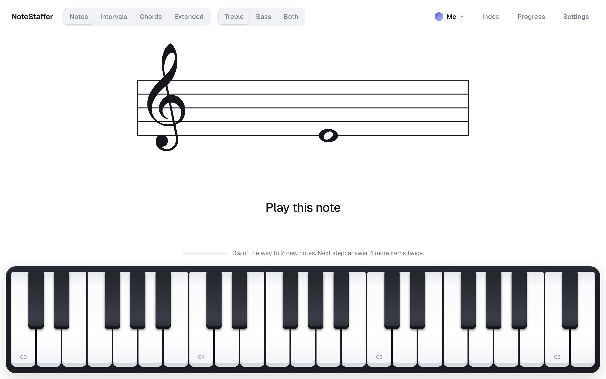

# NoteStuffer

### ▶ [Open NoteStuffer](https://og2t.github.io/note-stuffer/)

[](https://og2t.github.io/note-stuffer/)

A sight-reading trainer for the piano staff. It shows a note, interval or chord on the staff, you play it, and it measures how fast you answer. Items you know well come up less often; the ones you miss come back sooner, Anki style.

## What it does

- **Sets:** Notes, Intervals, Chords (triads and inversions) and Extended (sus, 6ths, 7ths with inversions, 9ths, 11ths, 13ths), on the treble staff, the bass staff, or both.
- **Input:** the on-screen keyboard, or a MIDI keyboard in Chrome or Edge (Settings → MIDI keyboard). Safari, including on iPad, has no Web MIDI.
- **Gradual unlocking:** new items unlock once every current one is played right 5 times in a row and fast enough, all natural notes and chords before any sharps or flats, with a level-up screen introducing them.
- **Cheatsheet:** hold Shift, Space or the middle pedal, or touch the staff, to see the name of every line and space. That answer then doesn't count toward your speed.
- **Keys:** pick a key signature in Settings (up to 4 sharps or flats). Notes, intervals and chords then come from that key's scale, with the signature drawn after the clef. Progress is kept per key.
- **Free play:** whatever you play is written on the staff, with a choice of sharps or flats, so you can check it against a printed score. Nothing is recorded.
- **Breaks:** a short round summary every 20 answers, with mix-ups and slowest items. Press any key or the sustain pedal to carry on.
- **Progress:** per-item reaction-time charts, failure rates, and the notes you confuse most.
- **Users:** separate progress per user, for example a Test user next to your own.

Progress is stored in the browser (IndexedDB) and stays on the device. Use Settings → Export progress to back it up or move it to another browser.

## Running locally

```bash
python3 serve.py 8642
```

Then open http://localhost:8642. The server disables caching so edits show up on reload.

The release in Settings (for example 0.1.9) is major.minor, set by hand in `version.js`, then the commit count, which a hook sets on every commit. Enable the hook once per clone:

```bash
git config core.hooksPath scripts/hooks
```
